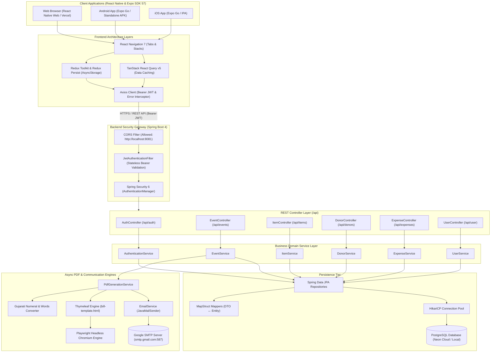
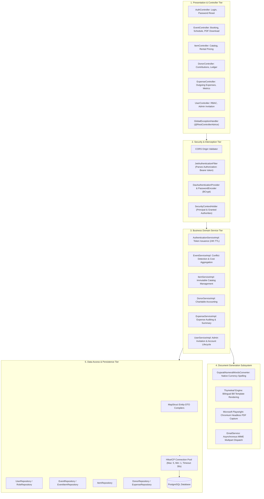
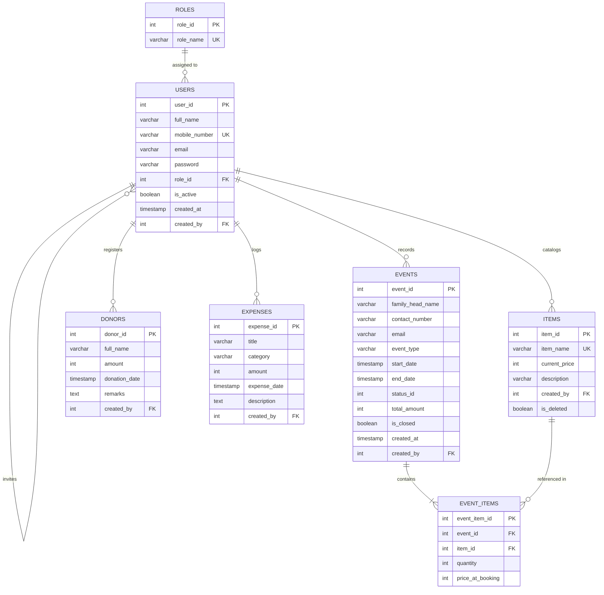
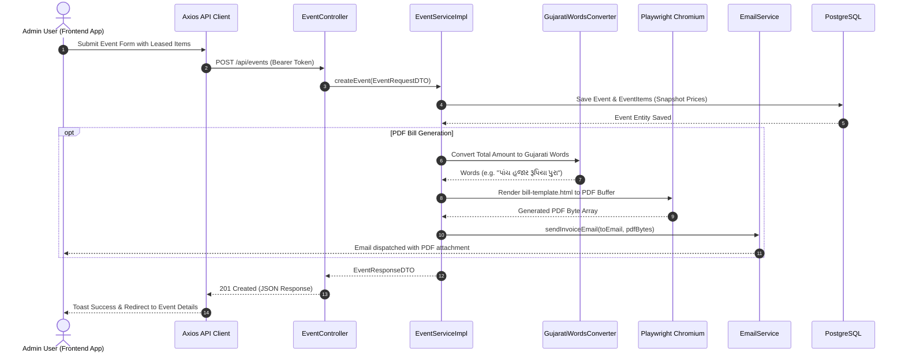

# 🏛️ Patel Samaj Community Management System — Frontend Application

[](https://docs.expo.dev/versions/v57.0.0/)
[](https://reactnative.dev/)
[](https://react.dev/)
[](https://www.typescriptlang.org/)
[](https://redux-toolkit.js.org/)
[](https://reactnavigation.org/)
[](https://callstack.github.io/react-native-paper/)
[](https://tanstack.com/query/latest)
[](https://spring.io/projects/spring-boot)
[](https://www.postgresql.org/)

A modern, multi-platform community portal built with **React Native**, **Expo SDK 57**, **TypeScript**, and **React Native Paper (Material 3)**. The client connects securely to a **Spring Boot 4 / PostgreSQL** backend, delivering seamless management for community hall reservations, inventory catalog leasing, charitable donations, operational expenses, administrator user management, and bilingual Gujarati PDF invoices.

---

## 📑 Table of Contents

- [🌟 Overview](#-overview)
- [✨ Key Features](#-key-features)
- [🏛️ Backend & System Architecture](#️-backend--system-architecture)
  - [1. Full-Stack End-to-End Architecture](#1-full-stack-end-to-end-architecture)
  - [2. Detailed Backend N-Tier Architecture](#2-detailed-backend-n-tier-architecture)
  - [3. Entity-Relationship Database Diagram (ERD)](#3-entity-relationship-database-diagram-erd)
  - [4. Automated Billing & Email Dispatch Sequence](#4-automated-billing--email-dispatch-sequence)
- [🛠️ Tech Stack & Libraries](#️-tech-stack--libraries)
- [⚙️ Prerequisites](#️-prerequisites)
- [🚀 Quick Start & Execution Guide](#-quick-start--execution-guide)
  - [Step 1: Set Up and Run the Backend](#step-1-set-up-and-run-the-backend)
  - [Step 2: Configure Frontend Environment (.env)](#step-2-configure-frontend-environment-env)
  - [Step 3: Install Frontend Dependencies](#step-3-install-frontend-dependencies)
  - [Step 4: Launch the Frontend Application](#step-4-launch-the-frontend-application)
- [📱 Running on Different Platforms](#-running-on-different-platforms)
  - [Web Browser](#web-browser)
  - [Android Device or Emulator](#android-device-or-emulator)
  - [iOS Simulator or iPhone](#ios-simulator-or-iphone)
- [🏗️ Building for Production](#️-building-for-production)
  - [Web Production Build](#web-production-build)
  - [Deploy to Vercel](#deploy-to-vercel)
  - [Native Android & iOS Builds (EAS)](#native-android--ios-builds-eas)
- [🌐 REST API Reference](#-rest-api-reference)
- [📂 Project Directory Structure](#-project-directory-structure)
- [🔧 Troubleshooting & FAQs](#-troubleshooting--faqs)

---

## 🌟 Overview

The **Patel Samaj Community Management System** modernizes and streamlines community administration. Instead of managing complex manual ledger books and paper receipts, administrators can access an intuitive, role-based digital dashboard across web and mobile devices.

### Highlights
- **Multi-Platform Single Codebase:** Runs natively on Web browsers, Android devices, and iOS.
- **Saffron & Slate Brand Identity:** Purpose-built Material Design 3 palette reflecting Gujarati heritage with clean modern UI aesthetics.
- **Offline-Ready Auth & State:** Seamless Redux Persist state caching with automated 24-hour JWT session validation and interceptors.
- **Live PDF & Asynchronous Email Dispatch:** Automatic generation of bilingual Gujarati invoices using headless Chromium with instant email delivery to community applicants.

---

## ✨ Key Features

| Module | Features & Capabilities |
| :--- | :--- |
| 📊 **Dashboard** | Real-time statistical metrics, booking density analytics, aggregate donations, and operational expenditure snapshots. |
| 📅 **Event & Hall Bookings** | Multi-day hall scheduling, conflict prevention, dynamic item lease selection, auto calculation, invoice downloading, and re-sending bills. |
| 📦 **Inventory Catalog** | Catalog of community items (utensils, sound systems, furniture) with frozen historical pricing snapshots during bookings. |
| 🤝 **Donation Register** | Comprehensive registry for charitable contributions, tracking donor details, dates, amounts, and notes. |
| 💸 **Expense Tracker** | Categorized expense entries, recurring utility logs, and financial balance calculation. |
| 👥 **Admin & Profile** | Role-Based Access Control (RBAC), admin invitation system, password resets, and profile management. |

---

## 🏛️ Backend & System Architecture

### 1. Full-Stack End-to-End Architecture

The following diagram illustrates how the frontend mobile and web clients communicate with the Spring Boot backend, security gateway, database, and background document generation pipeline:



---

### 2. Detailed Backend N-Tier Architecture

The backend follows an enterprise **N-Tier Layered Architecture** with strict boundary separation:



---

### 3. Entity-Relationship Database Diagram (ERD)

The relational database enforces data integrity with explicit foreign keys, cascading rules, and pricing snapshots:



> [!NOTE]
> **Immutable Pricing Snapshot Pattern:** The `EVENT_ITEMS` table records `price_at_booking`. This ensures that if the rental price in `ITEMS` is changed in the future, past invoices and event records maintain exact historical billing integrity.

---

### 4. Automated Billing & Email Dispatch Sequence

When an event is booked or updated, the system automatically computes totals, creates a bilingual Gujarati invoice PDF using Playwright Chromium, and dispatches it via Google SMTP:



---

## 🛠️ Tech Stack & Libraries

### Frontend
- **Framework:** React Native 0.86, Expo SDK 57 (`~57.0.4`)
- **Language:** TypeScript 6 (`~6.0.3`)
- **UI & Design:** React Native Paper (`5.15.3`, MD3 Theme), React Native Vector Icons, React Native SVG
- **Navigation:** React Navigation 7 (Stack & Bottom Tabs)
- **State Management:** Redux Toolkit 2.12, Redux Persist 6.0 (`@react-native-async-storage/async-storage`)
- **Server Cache & Networking:** TanStack React Query v5, Axios 1.18
- **Platform Compatibility:** React Native Web (`0.21.2`), Android, iOS

### Backend
- **Framework:** Spring Boot 4.0.6 (Java 17+)
- **Security:** Spring Security 6, JJWT (HMAC SHA-256 Stateless Tokens)
- **Database:** PostgreSQL (Neon Cloud or Local Instance), Spring Data JPA & Hibernate
- **Object Mapping:** MapStruct 1.5.5 with Lombok Binding
- **PDF Generation:** Microsoft Playwright 1.61 (Headless Chromium) & Thymeleaf 3.x
- **Mailing:** Spring Mail (JavaMailSender via Google SMTP)

---

## ⚙️ Prerequisites

Before running the application, make sure you have the following installed on your computer:

1. **Node.js:** `v18.x` or `v20.x` LTS ([Download Node.js](https://nodejs.org/))
2. **Package Manager:** `npm` (v9+ or v10+) or `yarn`
3. **Java Development Kit (JDK):** Version 17 or higher ([Eclipse Temurin / OpenJDK 17](https://adoptium.net/))
4. **PostgreSQL:** Version 14 or higher (or access to a cloud PostgreSQL database like Neon)
5. **Git:** ([Download Git](https://git-scm.com/))
6. **Testing Environments (Pick one or more):**
   - **Web Browser:** Google Chrome, Microsoft Edge, Brave, Safari, or Firefox
   - **Physical Mobile Device:** Install the **Expo Go** app from Google Play Store (Android) or Apple App Store (iOS)
   - **Emulators:** Android Studio (Android SDK & Virtual Device) or Xcode (macOS only)

---

## 🚀 Quick Start & Execution Guide

Follow these sequential steps to run the complete system locally.

### Step 1: Set Up and Run the Backend

The frontend communicates with the Spring Boot backend on port `8080`.

1. **Open a terminal** and navigate to the backend directory:
   ```bash
   cd "e:/Patel Samaj/patelsamaj-backend"
   ```

2. **Verify Database Configuration:**
   Inspect `src/main/resources/application.properties`. Ensure the PostgreSQL connection string is correct:
   ```properties
   server.port=8080
   spring.datasource.url=jdbc:postgresql://localhost:5432/PatelSamaj
   spring.datasource.username=postgres
   spring.datasource.password=your_password
   spring.jpa.hibernate.ddl-auto=update
   cors.allowed-origins=http://localhost:8081,http://localhost:19006
   ```
   *(Note: The repository includes default Neon cloud credentials for out-of-the-box development testing if local PostgreSQL is not configured).*

3. **Install the Playwright Chromium Browser Binary (Required for PDF generation):**
   Run the following command once to install headless Chromium:
   ```bash
   # Windows (PowerShell / Command Prompt)
   .\mvnw.cmd exec:java -e -D exec.mainClass=com.microsoft.playwright.CLI -D exec.args="install chromium"

   # macOS / Linux
   ./mvnw exec:java -e -D exec.mainClass=com.microsoft.playwright.CLI -D exec.args="install chromium"
   ```

4. **Start the Backend Server:**
   ```bash
   # Windows
   .\mvnw.cmd spring-boot:run

   # macOS / Linux
   ./mvnw spring-boot:run
   ```
   The backend will start and listen at **`http://localhost:8080`**.

---

### Step 2: Configure Frontend Environment (.env)

1. Open a new terminal and navigate to `patelsamaj-frontend`:
   ```bash
   cd "e:/Patel Samaj/patelsamaj-frontend"
   ```

2. Create your `.env` configuration file from the provided `.env.example`:
   ```bash
   # Windows (PowerShell)
   Copy-Item .env.example .env

   # Linux / macOS
   cp .env.example .env
   ```

3. **Configure the API URL for your target platform:**

   | Target Platform | `EXPO_PUBLIC_API_URL` setting | Explanation |
   | :--- | :--- | :--- |
   | **Web Browser** | `http://localhost:8080/api` | Direct localhost access from your browser. |
   | **Android Emulator** | `http://10.0.2.2:8080/api` | Special alias loopback for host machine in Android Emulator. |
   | **Physical Device (Expo Go)** | `http://<YOUR_LOCAL_IP>:8080/api` | Replace with your computer's Wi-Fi IP (e.g. `http://192.168.1.50:8080/api`). Both device and computer must be on the same Wi-Fi network. |

   Example `.env`:
   ```env
   EXPO_PUBLIC_API_URL=http://localhost:8080/api
   EXPO_PUBLIC_DEMO_MOBILE=9999999999
   EXPO_PUBLIC_DEMO_PASSWORD=76426707
   ```

---

### Step 3: Install Frontend Dependencies

Inside `patelsamaj-frontend`, install all required packages:

```bash
npm install
```

---

### Step 4: Launch the Frontend Application

Start the Expo development server:

```bash
npm start
```

This starts the Expo CLI interactive terminal:
```
› Press w │ open web browser
› Press a │ open Android emulator
› Press i │ open iOS simulator
› Press r │ reload app
› Press ? │ show all commands
```

---

## 📱 Running on Different Platforms

### Web Browser
The fastest way to test and experience the full application without mobile emulators:
```bash
npm run web
```
The application will bundle and open automatically in your browser at:
👉 **`http://localhost:8081`**

#### Default Login Credentials:
- **Mobile Number:** `9999999999`
- **Password:** `76426707`

---

### Android Device or Emulator

#### On Physical Android Device:
1. Ensure your computer and Android phone are connected to the **same Wi-Fi network**.
2. Update `.env` to point to your computer's local IP:
   ```env
   EXPO_PUBLIC_API_URL=http://192.168.1.50:8080/api
   ```
3. Run `npm start`.
4. Open the **Expo Go** app on your phone and scan the QR code displayed in your terminal.

#### On Android Studio Emulator:
1. Start an Android Virtual Device (AVD) from Android Studio.
2. In your `.env` file, set:
   ```env
   EXPO_PUBLIC_API_URL=http://10.0.2.2:8080/api
   ```
3. Run:
   ```bash
   npm run android
   ```

---

### iOS Simulator or iPhone

#### On iOS Simulator (macOS only):
```bash
npm run ios
```

#### On Physical iPhone:
1. Ensure both devices are on the same Wi-Fi network.
2. Set `EXPO_PUBLIC_API_URL=http://<YOUR_LOCAL_IP>:8080/api` in `.env`.
3. Run `npm start`.
4. Open the iOS Camera app, scan the QR code, and open it in **Expo Go**.

---

## 🏗️ Building for Production

### Web Production Build

To export an optimized, production-ready static web bundle:
```bash
npm run build:web
```
This generates the bundled output inside the `dist/` directory.

### Deploy to Vercel

The repository already includes `vercel.json` configured for Single Page Application (SPA) client-side routing rewrites:
```json
{
  "rewrites": [
    { "source": "/(.*)", "destination": "/index.html" }
  ]
}
```

To deploy using the Vercel CLI:
```bash
npm install -g vercel
vercel
```
Ensure you add the environment variable `EXPO_PUBLIC_API_URL` pointing to your hosted Spring Boot backend domain in the Vercel Project Settings.

### Native Android & iOS Builds (EAS)

For standalone `.apk`, `.aab`, or `.ipa` packages, use EAS (Expo Application Services):
```bash
npx eas login
npx eas build:configure
npx eas build --platform android --profile preview
```

---

## 🌐 REST API Reference

The frontend consumes the following backend REST endpoints:

### Authentication (`/api/auth`)
| Method | Endpoint | Description | Auth Required |
| :--- | :--- | :--- | :--- |
| `POST` | `/api/auth/login` | Authenticate using mobile & password; returns JWT token & user payload | ❌ No |
| `POST` | `/api/auth/forgot-password` | Initiates password reset email for an existing account | ❌ No |

### Events & Hall Bookings (`/api/events`)
| Method | Endpoint | Description | Auth Required |
| :--- | :--- | :--- | :--- |
| `GET` | `/api/events` | Retrieve list of all scheduled events and hall reservations | 🔒 Bearer JWT |
| `POST` | `/api/events` | Create a new event with date ranges, head of family, leased items & dispatch bill | 🔒 Bearer JWT |
| `GET` | `/api/events/{id}` | Retrieve detailed booking data and item snapshots for a single event | 🔒 Bearer JWT |
| `PUT` | `/api/events/{id}` | Update existing event details and inventory allocations | 🔒 Bearer JWT |
| `DELETE` | `/api/events/{id}` | Cancel/delete an event reservation | 🔒 Bearer JWT |
| `GET` | `/api/events/{id}/bill` | Download the generated bilingual Gujarati PDF bill | 🔒 Bearer JWT |
| `POST` | `/api/events/{id}/send-bill` | Re-trigger automated PDF invoice dispatch via email | 🔒 Bearer JWT |

### Inventory Catalog (`/api/items`)
| Method | Endpoint | Description | Auth Required |
| :--- | :--- | :--- | :--- |
| `GET` | `/api/items` | Fetch all active inventory catalog items with rental rates | 🔒 Bearer JWT |
| `POST` | `/api/items` | Add a new inventory item to the community catalog | 🔒 Bearer JWT |
| `GET` | `/api/items/{id}` | Fetch inventory item details | 🔒 Bearer JWT |
| `PUT` | `/api/items/{id}` | Update item description, rate, or status | 🔒 Bearer JWT |
| `DELETE` | `/api/items/{id}` | Soft-delete an item (retains historical invoice data) | 🔒 Bearer JWT |

### Donors & Contributions (`/api/donors`)
| Method | Endpoint | Description | Auth Required |
| :--- | :--- | :--- | :--- |
| `GET` | `/api/donors` | List all registered charitable donations | 🔒 Bearer JWT |
| `POST` | `/api/donors` | Log a new charitable donation receipt | 🔒 Bearer JWT |
| `GET` | `/api/donors/{id}` | Retrieve single donor entry | 🔒 Bearer JWT |
| `PUT` | `/api/donors/{id}` | Update donation entry | 🔒 Bearer JWT |
| `DELETE` | `/api/donors/{id}` | Remove donor record | 🔒 Bearer JWT |

### Expenses & Financial Accounting (`/api/expenses`)
| Method | Endpoint | Description | Auth Required |
| :--- | :--- | :--- | :--- |
| `GET` | `/api/expenses` | List all recorded community operational expenditures | 🔒 Bearer JWT |
| `POST` | `/api/expenses` | Record a new expense receipt | 🔒 Bearer JWT |
| `GET` | `/api/expenses/{id}` | Retrieve single expense record | 🔒 Bearer JWT |
| `PUT` | `/api/expenses/{id}` | Update expense details | 🔒 Bearer JWT |
| `DELETE` | `/api/expenses/{id}` | Remove expense record | 🔒 Bearer JWT |
| `GET` | `/api/expenses/summary` | Aggregate metrics of total expenses and category distributions | 🔒 Bearer JWT |

### User & Admin Management (`/api/user`)
| Method | Endpoint | Description | Auth Required |
| :--- | :--- | :--- | :--- |
| `GET` | `/api/user` | Fetch list of all registered administrators | 🔒 Bearer JWT |
| `POST` | `/api/user/invite` | Send an onboarding invitation for a new administrator | 🔒 Bearer JWT |
| `PUT` | `/api/user/profile` | Update current logged-in user profile | 🔒 Bearer JWT |
| `PUT` | `/api/user/change-password` | Update account password | 🔒 Bearer JWT |
| `DELETE` | `/api/user/{id}` | Deactivate/remove admin account | 🔒 Bearer JWT |

---

## 📂 Project Directory Structure

```plaintext
patelsamaj-frontend/
├── assets/                       # App icons, splash screens, logos
│   ├── icon.png
│   ├── splash-icon.png
│   └── favicon.png
├── src/
│   ├── api/                      # Networking & API integrations
│   │   ├── client.ts             # Axios instance, token interceptors, error parsers
│   │   ├── index.ts              # API barrel exports
│   │   └── services/             # Domain API services
│   │       ├── authApi.ts        # Login & password reset requests
│   │       ├── donorApi.ts       # Donor queries & mutations
│   │       ├── eventApi.ts       # Booking operations & PDF bill triggers
│   │       ├── expenseApi.ts     # Expense operations & summaries
│   │       ├── inventoryApi.ts   # Inventory catalog CRUD
│   │       └── userApi.ts        # Admin profile & invitations
│   ├── components/               # Reusable UI widgets & forms
│   │   ├── ConfirmDialog.tsx     # Delete & status confirmation modal
│   │   ├── DatePickerField.tsx   # Cross-platform date & time picker
│   │   ├── EmptyState.tsx        # Zero-state illustration placeholders
│   │   ├── ErrorState.tsx        # Retry error state screen
│   │   ├── ItemPickerModal.tsx   # Inventory multi-select picker
│   │   ├── LoadingScreen.tsx     # Fullscreen loading spinners
│   │   └── ScreenHeader.tsx      # Consistent saffron/navy top app bar
│   ├── context/                  # Global React contexts
│   │   └── ToastContext.tsx      # Application-wide feedback toasts
│   ├── hooks/                    # Custom React hooks
│   │   └── useAuthSession.ts     # Automatic token expiry & auto-logout monitor
│   ├── navigation/               # React Navigation configuration
│   │   ├── AppNavigator.tsx      # Root stack & bottom tab navigator definitions
│   │   └── types.ts              # Strongly-typed route navigation params
│   ├── screens/                  # Application screens
│   │   ├── auth/                 # Login & ForgotPassword screens
│   │   ├── dashboard/            # High-level metrics & quick actions
│   │   ├── donors/               # Donor list, donor detail, donor form
│   │   ├── events/               # Event calendar, booking form, invoice actions
│   │   ├── expenses/             # Expense list, summary screen, expense form
│   │   ├── inventory/            # Item inventory list, details & form
│   │   └── profile/              # Admin profile, change password, invite admin
│   ├── store/                    # Redux Toolkit store
│   │   ├── authSlice.ts          # Authentication state & persistent user tokens
│   │   └── index.ts              # Store configure & Redux Persist integration
│   ├── theme/                    # Material 3 styling & color tokens
│   │   └── index.ts              # Saffron/Navy primary theme definitions
│   ├── types/                    # Shared TypeScript interfaces & models
│   │   └── index.ts              # Event, Item, Donor, Expense & User types
│   └── utils/                    # Helper functions & utilities
│       ├── currency.ts           # Indian Rupee (₹) formatters
│       ├── dateUtils.ts          # Date-time & calendar formatting helpers
│       ├── pdfHandler.ts         # Native & Web PDF download & share handler
│       └── tokenManager.ts       # JWT expiration timestamp calculations
├── .env                          # Local environment variables (ignored by git)
├── .env.example                  # Template for environment variables
├── .gitignore                    # Git ignore file
├── App.tsx                       # Main application entry component
├── app.json                      # Expo configuration & plugins
├── package.json                  # NPM dependencies & scripts
├── tsconfig.json                 # TypeScript compiler configuration
└── vercel.json                   # Vercel deployment & routing configuration
```

---

## 🔧 Troubleshooting & FAQs

### 1. `Network Error` or `AxiosError: Network Error` on Mobile
- **Cause:** Mobile devices cannot resolve `http://localhost:8080`.
- **Solution:**
  - For **Android Emulator**, use: `EXPO_PUBLIC_API_URL=http://10.0.2.2:8080/api`
  - For **Physical Phone (Expo Go)**, find your computer's local Wi-Fi IP address (run `ipconfig` on Windows or `ifconfig` on Mac/Linux) and set:
    `EXPO_PUBLIC_API_URL=http://192.168.x.x:8080/api`
  - Ensure your computer firewall allows incoming connections on port `8080`.

### 2. CORS Errors in the Web Browser
- **Cause:** The backend is rejecting requests from `http://localhost:8081`.
- **Solution:** Check `cors.allowed-origins` in the backend's `application.properties`. Ensure `http://localhost:8081` is present.

### 3. Clear Expo Bundler Cache
If you encounter bundler caching issues after changing dependencies or configuration:
```bash
npx expo start -c
```

### 4. PDF Generation Fails on the Backend
- **Cause:** Microsoft Playwright requires headless Chromium binaries.
- **Solution:** In the `patelsamaj-backend` folder, execute:
  ```bash
  .\mvnw.cmd exec:java -e -D exec.mainClass=com.microsoft.playwright.CLI -D exec.args="install chromium"
  ```

---

## 📄 License

This project is licensed under the MIT License — see the [LICENSE](LICENSE) file for details.
